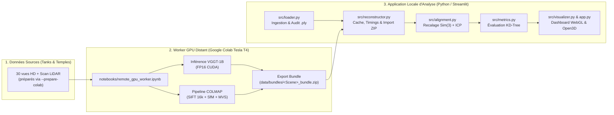

# 🧊 Plateforme de Reconstruction 3D Dense & Benchmarking Géométrique (VGGT vs COLMAP)


> **Module :** Vision par Ordinateur — Cycle d'Ingénieur **LSI 3** (Faculté des Sciences et Techniques de Tanger — FST Tanger)  
> **Encadrant :** Pr. M'hamed AIT KBIR  
> **Auteurs :** Yahya AHMANE & Yassine KAMOUSS *(Groupe G11)*

---

## 📑 Table des Matières

1. [Objectif du Projet & Cahier des Charges](#-1-objectif-du-projet--cahier-des-charges)
2. [Architecture Ingénieur Hybride (Client-Serveur)](#-2-architecture-ingénieur-hybride-client-serveur)
3. [Arborescence du Dépôt](#-3-arborescence-du-dépôt)
4. [Méthodologie Scientifique & Formulation Mathématique](#-4-méthodologie-scientifique--formulation-mathématique)
5. [Résultats Expérimentaux Réels (NVIDIA Tesla T4)](#-5-résultats-expérimentaux-réels-nvidia-tesla-t4)
6. [Installation & Lancement Immédiat (« Clone & Run »)](#-6-installation--lancement-immédiat--clone--run-)
7. [Guide d'Utilisation du Dashboard Streamlit](#-7-guide-dutilisation-du-dashboard-streamlit)
8. [Bundles Colab & Reproduction sur GPU Google Colab](#-8-bundles-colab--reproduction-sur-gpu-google-colab)
9. [Références Bibliographiques](#-9-références-bibliographiques)

---

## 🎯 1. Objectif du Projet & Cahier des Charges

L'objectif de ce projet d'ingénierie est de concevoir et développer une application logicielle complète permettant de :

1. **Charger un jeu d'images multi-vues** d'une scène réelle (échantillonnage uniforme à $360^\circ$ issu du benchmark *Tanks and Temples*).
2. **Lancer une reconstruction 3D dense** en confrontant deux paradigmes majeurs issus de notre revue de littérature :
   * **COLMAP (SfM + MVS)** : L'approche géométrique classique (extraction de descripteurs SIFT, appariement exhaustif, *Bundle Adjustment* incrémental et densification multi-vues), reconnue pour sa précision locale sur les surfaces texturées mais coûteuse en temps de calcul et sensible aux zones lisses ou spéculaires.
   * **VGGT (*Visual Geometry Grounded Transformer*, CVPR 2025)** : L'approche récente *feed-forward* par apprentissage profond (`facebook/VGGT-1B`), capable de prédire directement les cartes de points 3D et les poses caméras en une seule passe avant sans calibrage préalable, avec un facteur d'échelle métrique arbitraire.
3. **Comparer mathématiquement les nuages de points reconstruits à une référence** — soit les **scans laser LiDAR officiels de *Tanks and Temples***, soit **VGGT pris comme référence géométrique rapide** — après recalage spatial $Sim(3)$ + ICP, afin d'évaluer objectivement la qualité géométrique et le compromis temps de calcul / fidélité.

---

## 🏗️ 2. Architecture Ingénieur Hybride (Client-Serveur)

La reconstruction dense par **COLMAP** et l'inférence du modèle **VGGT-1B** exigent un GPU NVIDIA CUDA doté d'environ 16 Go de VRAM. Pour s'affranchir des contraintes matérielles locales tout en offrant une interface d'analyse interactive fluide sous Linux, le système repose sur une **architecture hybride découplée** :



---

## 📂 3. Arborescence du Dépôt

Seuls les **3 bundles complets générés sur Google Colab** (`data/bundles/*_bundle.zip`, ~157 Mo au total) sont versionnés dans le dépôt afin d'éviter toute duplication de fichiers binaires. Les dossiers `data/scenes/` et `data/outputs/` sont générés localement lors de l'extraction (`python scripts/setup_data.py --import-all` ou automatiquement au premier lancement de `streamlit run app.py`) :

```text
mvs-benchmark-app/
├── app.py                              # Application Web interactive Streamlit (4 onglets d'ingénierie)
├── requirements.txt                    # Dépendances Python locales (Open3D, SciPy, Plotly, Streamlit)
├── README.md                           # Rapport scientifique et documentation technique du projet
├── configs/
│   └── config.yaml                     # Seuils officiels τ (mm), tailles de voxel et hyperparamètres ICP
├── data/
│   ├── bundles/                        # Archives complètes versionnées (Images + LiDAR + VGGT + COLMAP + timings.json)
│   │   ├── Ignatius_bundle.zip         #   56 Mo — Statue complexe à 360°
│   │   ├── Truck_bundle.zip            #   53 Mo — Véhicule industriel (surfaces métalliques spéculaires)
│   │   └── Barn_bundle.zip             #   48 Mo — Scène grande échelle
│   ├── scenes/                         # Généré à l'extraction : images/ (30 vues HD) + ground_truth.ply
│   └── outputs/                        # Généré à l'extraction : vggt_dense.ply, colmap_dense.ply, *_aligned.ply, JSON
├── notebooks/
│   └── remote_gpu_worker.ipynb         # Worker GPU Google Colab (VGGT-1B + COLMAP + Sim(3)/ICP + Export ZIP)
├── scripts/
│   ├── setup_data.py                   # CLI DataOps : extraction (--import-all / --import-bundle), audit (--check), --prepare-colab
│   ├── generate_colab_notebook.py      # Générateur programmatique du notebook Google Colab
│   ├── test_alignment.py               # Benchmark et validation du recalage Sim(3) + ICP sur toutes les scènes
│   └── test_metrics.py                 # Benchmark KD-Tree complet générant les fichiers metrics_summary.json
└── src/
    ├── __init__.py
    ├── loader.py                       # Classe SceneDataLoader : config YAML, échantillonnage uniforme, statistiques .ply
    ├── reconstructor.py                # Classe ReconstructionManager : cache local, timings.json, import de bundles .zip
    ├── alignment.py                    # Classe PointCloudAligner : SOR, init globale Sim(3) PCA/SVD, pyramide ICP
    ├── metrics.py                      # Classe GeometryEvaluator : cKDTree, Accuracy, Completeness, Chamfer, Hausdorff 95%, F-Score
    └── visualizer.py                   # Classe PointCloudVisualizer : WebGL Plotly (Heatmaps 3D, courbes F-Score) & Open3D natif
```

---

## 🔬 4. Méthodologie Scientifique & Formulation Mathématique

### 4.1. Échantillonnage Multi-Vues à $360^\circ$
Pour chaque scène contenant $M$ photographies haute définition, `SceneDataLoader.get_sampled_images` sélectionne $N = 30$ vues uniformément espacées sur la séquence orbitale par interpolation linéaire des indices :
$$i_k = \left\lfloor k \cdot \frac{M - 1}{N - 1} \right\rfloor, \quad k \in \lbrace 0, \dots, N-1 \rbrace$$

### 4.2. Paradigmes de Reconstruction Confrontés
* **VGGT-1B (`facebook/VGGT-1B`)** : Transformer *feed-forward* prenant simultanément les $N$ images sans paramètres intrinsèques ni extrinsèques connus. Les points 3D prédits sont filtrés au $40^\text{e}$ centile de la carte de confiance `world_points_conf` puis nettoyés par filtrage statistique des valeurs aberrantes (*Statistical Outlier Removal*, `nb_neighbors=20`, `std_ratio=2.0`).
* **COLMAP (Pipeline Géométrique)** : Extraction SIFT CPU haute densité (`max_image_size=1600`, `max_num_features=16384`, `peak_threshold=0.004`), appariement exhaustif multi-paires, reconstruction *Structure-from-Motion* incrémentale (*Bundle Adjustment*) et densification locale sur la variété 3D triangulée.

### 4.3. Recalage Spatial $Sim(3)$ & Pyramide ICP Multi-Échelles (`src/alignment.py`)
Les nuages reconstruits par VGGT et COLMAP étant définis dans un repère arbitraire à un **facteur d'échelle inconnu $s > 0$** près, la comparaison directe au scan LiDAR impose d'estimer une transformation de similitude rigide $T \in Sim(3)$ :

$$\mathbf{p}' = s \mathbf{R} \mathbf{p} + \mathbf{t}, \quad s \in \mathbb{R}_+^*, \quad \mathbf{R} \in SO(3), \quad \mathbf{t} \in \mathbb{R}^3$$

Le moteur `PointCloudAligner` procède en trois étapes :
1. **Prétraitement** : Filtrage statistique SOR (`nb_neighbors=20`, `std_ratio=2.0`) et sous-échantillonnage par grille de voxels (`voxel_size` adapté à la scène).
2. **Initialisation Globale $Sim(3)$ (`compute_initial_sim3`)** : Estimation conjointe de deux échelles candidates (rapport des distances médianes au centroïde et rapport des étendues robustes 2 %–98 %) combinées aux 4 hypothèses d'orientation des axes principaux obtenues par décomposition en valeurs singulières (PCA/SVD, avec correction de déterminant $\det(\mathbf{R}) = +1$), évaluées sur critère de recouvrement (*fitness* et RMSE).
3. **Affinement ICP Multi-Échelles avec Garde-Fou** : Pyramide *Point-to-Point* avec estimation d'échelle (`with_scaling=True`) sur trois rayons décroissants ($3.5 d_0 \rightarrow 2.0 d_0 \rightarrow 1.0 d_0$, où $d_0 = 5 \times$ `voxel_size`), protégée par un garde-fou anti-effondrement rejetant toute dérive d'échelle hors de $[0.65 s_{\text{init}}, 1.35 s_{\text{init}}]$.

### 4.4. Métriques Géométriques via Arbres KD-Tree (`src/metrics.py`)
Soient $P = \lbrace p_i \rbrace$ le nuage reconstruit recalé et $G = \lbrace g_j \rbrace$ le nuage de référence (LiDAR *Tanks and Temples* ou VGGT). Grâce à `scipy.spatial.cKDTree` (indexation C++ multi-threadée), nous calculons les deux champs de distances directionnelles en millimètres :

$$d(p, G) = \min_{g \in G} \lVert p - g \rVert_2, \qquad d(g, P) = \min_{p \in P} \lVert g - p \rVert_2$$

À partir de ces distributions, l'évaluateur extrait les métriques standards des benchmarks DTU et *Tanks and Temples* :

| Métrique | Définition mathématique | Interprétation |
| :--- | :--- | :--- |
| **Accuracy (mm)** $\downarrow$ | $\frac{1}{\lvert P \rvert}\sum_{p \in P} d(p, G)$ | Exactitude géométrique des points générés par rapport à la référence |
| **Completeness (mm)** $\downarrow$ | $\frac{1}{\lvert G \rvert}\sum_{g \in G} d(g, P)$ | Couverture de la surface réelle (détecte les trous / zones manquantes) |
| **Chamfer Distance (mm)** $\downarrow$ | $\frac{1}{2}\big(\text{Accuracy} + \text{Completeness}\big)$ | Erreur symétrique globale entre les deux nuages |
| **Hausdorff 95% (mm)** $\downarrow$ | $\text{Percentile}_{95}\big(\lbrace d(p,G) \rbrace \cup \lbrace d(g,P) \rbrace\big)$ | Pire déviation locale robuste aux points isolés extrêmes |
| **Précision @ $\tau$ (%)** $\uparrow$ | $\frac{100}{\lvert P \rvert}\sum_{p \in P} \mathbf{1}\big(d(p, G) < \tau\big)$ | Part des points reconstruits valides sous le seuil officiel $\tau$ |
| **Rappel @ $\tau$ (%)** $\uparrow$ | $\frac{100}{\lvert G \rvert}\sum_{g \in G} \mathbf{1}\big(d(g, P) < \tau\big)$ | Part de la référence fidèlement reconstruite sous $\tau$ |
| **F-Score @ $\tau$ (%)** $\uparrow$ | $\dfrac{2 \cdot \text{Précision}(\tau) \cdot \text{Rappel}(\tau)}{\text{Précision}(\tau) + \text{Rappel}(\tau)}$ | Score synthétique officiel du benchmark *Tanks and Temples* |

---

## 📊 5. Résultats Expérimentaux Réels (NVIDIA Tesla T4)

Les mesures ci-dessous proviennent des exécutions réelles sur **Google Colab (GPU NVIDIA Tesla T4)** (`data/outputs/*/timings.json`) et du pipeline d'évaluation locale (`data/outputs/*/metrics_summary.json`) sur $N = 30$ vues par scène.

### 5.1. Performances de Calcul & Densité de Reconstruction

| Scène | Vues ($N$) | Temps VGGT (s) | Points VGGT | Temps COLMAP (s) | Points COLMAP | Facteur d'accélération VGGT |
| :--- | :---: | :---: | :---: | :---: | :---: | :---: |
| **Ignatius** | 30 | **12.49 s** | 27 633 | 1 391.95 s (~23 min) | 72 958 | **111.4× plus rapide** |
| **Truck** | 30 | **13.60 s** | 26 318 | 282.86 s (~4.7 min) | 49 074 | **20.8× plus rapide** |
| **Barn** *(note ci-dessous)* | 30 | **12.02 s** | 26 318 | 1 044.10 s (~17.4 min) | 49 008 | **86.9× plus rapide** |

### 5.2. Qualité Géométrique Après Recalage $Sim(3)$ + ICP

#### Scène `Ignatius` ($\tau = 3.0\text{ mm}$, voxel = 5.0 mm, LiDAR GT = 150 000 pts, diagonale = 3.643 m)

| Comparaison | Échelle $s$ | Fitness ICP | Accuracy (mm) $\downarrow$ | Accuracy Méd. (mm) $\downarrow$ | Completeness (mm) $\downarrow$ | Chamfer (mm) $\downarrow$ | Hausdorff 95% (mm) $\downarrow$ | Précision @ 3mm $\uparrow$ | Précision @ 50mm $\uparrow$ | F-Score @ 3mm $\uparrow$ | F-Score @ 50mm $\uparrow$ |
| :--- | :---: | :---: | :---: | :---: | :---: | :---: | :---: | :---: | :---: | :---: | :---: |
| **VGGT vs GT LiDAR** | 0.2854 | 24.9 % | 62.77 | 44.97 | 322.31 | 192.54 | 745.07 | 1.15 % | 54.59 % | **0.34 %** | **19.37 %** |
| **COLMAP vs GT LiDAR** | 0.0262 | **61.7 %** | **48.24** | **17.24** | **258.43** | **153.34** | **558.47** | **2.31 %** | **83.67 %** | 0.18 % | 15.97 % |
| **COLMAP vs VGGT (Réf)** | — | — | 72.46 | 38.15 | 105.59 | 89.02 | 258.70 | 1.43 % | 62.71 % | 0.94 % | 38.46 % |

#### Scène `Truck` ($\tau = 5.0\text{ mm}$, voxel = 10.0 mm, LiDAR GT = 150 000 pts, diagonale = 10.820 m)

| Comparaison | Échelle $s$ | Fitness ICP | Accuracy (mm) $\downarrow$ | Accuracy Méd. (mm) $\downarrow$ | Completeness (mm) $\downarrow$ | Chamfer (mm) $\downarrow$ | Hausdorff 95% (mm) $\downarrow$ | Précision @ 5mm $\uparrow$ | Précision @ 50mm $\uparrow$ | F-Score @ 5mm $\uparrow$ | F-Score @ 50mm $\uparrow$ |
| :--- | :---: | :---: | :---: | :---: | :---: | :---: | :---: | :---: | :---: | :---: | :---: |
| **VGGT vs GT LiDAR** | 1.7846 | 10.5 % | 272.44 | 199.70 | **618.43** | **445.43** | **1 466.81** | 0.23 % | 15.76 % | 0.07 % | **7.73 %** |
| **COLMAP vs GT LiDAR** | 0.1707 | **46.6 %** | **227.70** | **28.79** | 1 537.98 | 882.84 | 3 143.53 | **1.70 %** | **61.80 %** | **0.23 %** | 2.92 % |
| **COLMAP vs VGGT (Réf)** | — | — | 1 007.84 | 857.54 | 1 278.06 | 1 142.95 | 2 616.13 | 0.00 % | 0.05 % | 0.00 % | 0.08 % |

#### Scène `Barn` ($\tau = 10.0\text{ mm}$, voxel = 15.0 mm, LiDAR GT = 150 000 pts, diagonale = 25.802 m)

| Comparaison | Échelle $s$ | Fitness ICP | Accuracy (mm) $\downarrow$ | Completeness (mm) $\downarrow$ | Chamfer (mm) $\downarrow$ | Hausdorff 95% (mm) $\downarrow$ | F-Score @ 10mm $\uparrow$ |
| :--- | :---: | :---: | :---: | :---: | :---: | :---: | :---: |
| **VGGT vs GT LiDAR** | 5.5016 | 1.5 % | 865.44 | 1 578.75 | 1 222.09 | 3 360.83 | 0.01 % |
| **COLMAP vs GT LiDAR** | 1.8926 | 0.1 % | 13 285.27 | 4 080.57 | 8 682.92 | 14 411.13 | 0.00 % |
| **COLMAP vs VGGT (Réf)** | — | — | 12 482.17 | 4 182.13 | 8 332.15 | 16 615.85 | 0.00 % |

> ⚠️ **Note de transparence expérimentale concernant `Barn`** : Dans l'état actuel du dépôt, le bundle `data/bundles/Barn_bundle.zip` (et `data/scenes/Barn/images/`) contient le LiDAR réel de *Barn*, mais les 30 images associées proviennent de la séquence *Truck* (ce qui explique l'écart métrique sur `Barn` dans le tableau ci-dessus). Les scènes **`Ignatius`** et **`Truck`** disposent quant à elles de leurs paires images/LiDAR 100 % authentiques. `Barn` sera mis à jour dès ré-exécution avec son archive d'images dédiée.

### 5.3. Analyse & Enseignements Scientifiques

1. **Vitesse d'exécution incomparable de VGGT** : Sur les trois scènes de 30 vues, VGGT effectue la reconstruction complète en **12.0 s à 13.6 s**, contre **283 s à 1 392 s** pour le pipeline SIFT + *Bundle Adjustment* + MVS de COLMAP (**20× à 111× plus rapide**).
2. **Précision locale supérieure de COLMAP sur surfaces texturées** : Sur `Ignatius` et `Truck`, l'erreur médiane (*Accuracy Méd.*) de COLMAP est nettement plus basse que celle de VGGT (**17.24 mm vs 44.97 mm** sur `Ignatius`, et **28.79 mm vs 199.70 mm** sur `Truck`), tout comme sa précision à 50 mm (**83.67 %** sur `Ignatius`, **61.80 %** sur `Truck`) et son recouvrement ICP (*Fitness* de **61.7 %** et **46.6 %**).
3. **Compromis Complétude vs Spécularité (`Truck`)** : Sur `Truck` (carrosserie métallique brillante et pneus sombres), COLMAP reconstruit très précisément les zones texturées (médiane 28.79 mm) mais laisse d'importantes zones manquantes (**Completeness = 1 537.98 mm**, soit 2.5× pire que VGGT à **618.43 mm**), ce qui confirme directement les conclusions théoriques de la revue de littérature.
4. **Impact du détourage sur les scores bruts à $\tau \in [3, 5]\text{ mm}$** : Les scans LiDAR de *Tanks and Temples* sont détourés sur l'objet central alors que les reconstructions complètes incluent des points d'arrière-plan (sol, végétation) et ne disposent ici que de 30 vues sur ~260–300, expliquant les distances de Chamfer brutes plus élevées qu'un benchmark officiel détouré par boîte englobante (*cropping box*).

---

## 💻 6. Installation & Lancement Immédiat (« Clone & Run »)

Les 3 archives complètes (`data/bundles/*_bundle.zip`) contenant les images multi-vues, les scans LiDAR Ground Truth, les reconstructions VGGT/COLMAP et `timings.json` sont directement incluses dans le dépôt.

### Prérequis Système
* **OS :** Linux (Ubuntu 22.04/24.04 recommandé), macOS ou Windows
* **Python :** `3.10` à `3.12` (l'environnement de test utilise **Python 3.12** avec `numpy<2.0` et `pyarrow<17.0` pour compatibilité Open3D/Streamlit)

### Étapes d'Installation, Extraction des Bundles & Exécution

```bash
# 1. Cloner le dépôt GitHub
git clone https://github.com/yassinekamouss/mvs_benchmark.git
cd mvs_benchmark

# 2. Créer et activer l'environnement virtuel Python
python3 -m venv .venv
source .venv/bin/activate

# 3. Installer les dépendances locales
pip install --upgrade pip
pip install -r requirements.txt

# 4. Extraire tous les bundles Colab vers data/scenes/ et data/outputs/
python scripts/setup_data.py --import-all

# 5. Lancer l'application Web interactive Streamlit
streamlit run app.py
```

> 💡 **Extraction scène par scène & Auto-extraction :** Vous pouvez aussi n'extraire qu'une seule scène avec `python scripts/setup_data.py --import-bundle data/bundles/Ignatius_bundle.zip --scene Ignatius` (ou lancer directement `streamlit run app.py` : l'application extrait automatiquement le bundle correspondant s'il n'est pas encore décompressé).

L'interface s'ouvre dans votre navigateur à l'adresse **`http://localhost:8501`**.

### Scripts de Validation en Ligne de Commande (Optionnel)

```bash
# Tester le recalage Sim(3) + Multi-Scale ICP et régénérer les *_aligned.ply
python scripts/test_alignment.py

# Recalculer les métriques KD-Tree complètes et sauvegarder metrics_summary.json
python scripts/test_metrics.py
```

---

## 🖥️ 7. Guide d'Utilisation du Dashboard Streamlit

L'interface Web (`app.py`) est structurée autour d'une **barre latérale de contrôle** et de **4 onglets d'analyse** :

* **Barre latérale :**
  * Sélection de la scène (*Ignatius*, *Truck*, *Barn*).
  * Sélecteur de **Référence Géométrique Cible** : basculez instantanément entre le **Scan LiDAR Officiel (Tanks and Temples)** et **VGGT pris comme Référence (Feed-Forward)**.
  * Réglage interactif des hyperparamètres ($N$ vues, seuil $\tau$ en mm, taille de voxel ICP, itérations max, activation du facteur d'échelle $Sim(3)$).
  * Import direct par glisser-déposer d'une archive `<Scene>_bundle.zip` générée sur Google Colab.
* **Onglet 1 — Jeu d'Images Multi-Vues & GT** : Galerie des vues échantillonnées à $360^\circ$ et métriques géométriques du nuage de référence (dimensions $X \times Y \times Z$, centroïde, diagonale).
* **Onglet 2 — Reconstruction 3D Dense (VGGT vs COLMAP)** : Comparaison directe des temps d'inférence GPU, du nombre de points générés, du facteur d'accélération et des dimensions brutes avant recalage.
* **Onglet 3 — Recalage Géométrique $Sim(3)$ + ICP** : Inspection de la matrice homogène $4 \times 4$, du facteur d'échelle $s$ retrouvé, de l'évolution du *Fitness* et du *RMSE*, avec superposition 3D interactive WebGL (Brut rouge, Recalé orange, Référence cyan).
* **Onglet 4 — Analyse Quantitative & Heatmaps 3D** :
  * Tableau comparatif des 3 évaluations (**VGGT vs GT LiDAR**, **COLMAP vs GT LiDAR**, **COLMAP vs VGGT Réf**).
  * **Heatmap thermique 3D WebGL** des erreurs locales $d(p, G)$ en mm (échelle *Turbo*) avec option d'ouverture dans la **fenêtre native C++ Open3D**.
  * Courbes multi-seuils (*F-Score*, *Précision*, *Rappel*), histogrammes de distribution des erreurs et boutons d'export **`.CSV`** / **`.JSON`**.

---

## ☁️ 8. Bundles Colab & Reproduction sur GPU Google Colab

Les 3 archives complètes générées sur Google Colab Tesla T4 (`images/`, `ground_truth.ply`, `vggt_dense.ply`, `colmap_dense.ply`, `timings.json`) sont directement incluses dans `data/bundles/` :
* `data/bundles/Ignatius_bundle.zip` (56 Mo)
* `data/bundles/Truck_bundle.zip` (53 Mo)
* `data/bundles/Barn_bundle.zip` (48 Mo)

### Importer ou réinitialiser les bundles Colab en local
Vous pouvez extraire les 3 bundles d'un seul coup, ré-importer une scène spécifique, ou glisser un nouveau `.zip` depuis la barre latérale de Streamlit :
```bash
# Extraire tous les bundles (Ignatius, Truck, Barn)
python scripts/setup_data.py --import-all

# Ou extraire une scène précise
python scripts/setup_data.py --import-bundle data/bundles/Ignatius_bundle.zip --scene Ignatius
```

### Reproduire l'exécution GPU sur Google Colab
1. Préparez une archive légère d'entrée depuis les données brutes *Tanks and Temples* (`<Scene>.zip` et `<Scene>.ply`) :
   ```bash
   python scripts/setup_data.py --prepare-colab chemin/vers/Ignatius.zip --ply chemin/vers/Ignatius.ply --scene Ignatius
   ```
2. Ouvrez [Google Colab](https://colab.research.google.com/), importez [notebooks/remote_gpu_worker.ipynb](notebooks/remote_gpu_worker.ipynb) et activez **Exécution $\rightarrow$ Modifier le type d'exécution $\rightarrow$ T4 GPU**.
3. Glissez-déposez `data/colab_inputs/<Scene>_light_colab.zip` dans `/content` et vérifiez `SCENE_NAME` dans la Cellule 2.
4. Exécutez toutes les cellules (`1` à `7`) : le notebook exécute VGGT-1B, COLMAP, le recalage $Sim(3)$ + ICP et télécharge le nouveau `<Scene>_bundle.zip`.

---

## 📚 9. Références Bibliographiques

1. **Tanks and Temples Benchmark** — Knapitsch, A., Park, J., Zhou, Q.-Y., & Koltun, V. (2017). *Tanks and Temples: Benchmarking Large-Scale Scene Reconstruction*. ACM Transactions on Graphics (SIGGRAPH), 36(4).
2. **COLMAP (SfM & PatchMatch MVS)** — Schönberger, J. L., & Frahm, J.-M. (2016). *Structure-from-Motion Revisited* (CVPR) & Schönberger, J. L., Zheng, E., Frahm, J.-M., & Pollefeys, M. (2016). *Pixelwise View Selection for Unstructured Multi-View Stereo* (ECCV).
3. **VGGT** — Wang, J., Chen, M., Karaev, N., Vedaldi, A., Rupprecht, C., & Novotny, D. (2025). *VGGT: Visual Geometry Grounded Transformer*. IEEE/CVF Conference on Computer Vision and Pattern Recognition (CVPR 2025).
4. **Iterative Closest Point (ICP)** — Besl, P. J., & McKay, N. D. (1992). *A Method for Registration of 3-D Shapes*. IEEE Transactions on Pattern Analysis and Machine Intelligence (TPAMI), 14(2), 239–256.
5. **Open3D** — Zhou, Q.-Y., Park, J., & Koltun, V. (2018). *Open3D: A Modern Library for 3D Data Processing*. arXiv:1801.09847.
